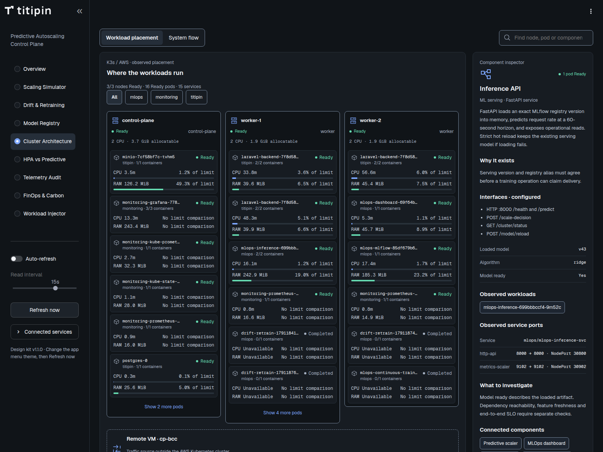

# Panduan Lengkap Dashboard Titipin MLOps

Dokumentasi halaman, section, card, grafik, tabel, input, tombol, serta fungsi operasionalnya.

**Tanggal penyusunan:** 13 Oktober 2026. **Acuan kode:** hasil merge PR #15, commit `de6a5ae`, dengan implementasi dashboard sampai `0305540`. **URL dashboard:** <https://mlops.titipin.me>.

Panduan ini menjelaskan perilaku yang sudah ada di kode. Tujuan penggunaan setiap komponen menjawab kapan komponen tersebut dipakai dalam observasi, demonstrasi, investigasi, atau pengoperasian sistem. Fitur yang belum tersedia disebutkan secara eksplisit. Penyusunan panduan tidak menjalankan workload, retraining, atau deployment baru.

## Daftar isi

- [1. Peta halaman dan cara membaca data](#1-peta-halaman-dan-cara-membaca-data)
- [2. Komponen global dan sidebar](#2-komponen-global-dan-sidebar)
- [3. Overview](#3-overview)
- [4. Scaling Simulator](#4-scaling-simulator)
- [5. Drift & Retraining](#5-drift--retraining)
- [6. Model Registry](#6-model-registry)
- [7. Cluster Architecture](#7-cluster-architecture)
- [8. HPA vs Predictive](#8-hpa-vs-predictive)
- [9. Telemetry Audit](#9-telemetry-audit)
- [10. FinOps & Carbon](#10-finops--carbon)
- [11. Workload Injector](#11-workload-injector)
- [12. Panel lifecycle yang digunakan bersama](#12-panel-lifecycle-yang-digunakan-bersama)
- [13. Kamus kolom tabel dan ekspor](#13-kamus-kolom-tabel-dan-ekspor)
- [14. Sumber data, refresh, dan persistensi](#14-sumber-data-refresh-dan-persistensi)
- [15. Alur penggunaan berdasarkan kebutuhan](#15-alur-penggunaan-berdasarkan-kebutuhan)
- [16. Batas fitur dan pemeliharaan dokumentasi](#16-batas-fitur-dan-pemeliharaan-dokumentasi)

## 1. Peta halaman dan cara membaca data

Dashboard menggunakan satu aplikasi Streamlit dengan **9 workspace**. Workspace dipilih dari sidebar; ini bukan sembilan aplikasi terpisah. Urutan berikut sama dengan menu aplikasi.

| Workspace | Tujuan utama | Isi utama | Aksi yang tersedia |
|---|---|---|---|
| **Overview** | Memahami kondisi serving dan keputusan autoscaling terakhir. | 4 KPI, 2 grafik utama, kesehatan model, status replika, event, ringkasan keputusan, snapshot SLO. | Inspeksi, ekspor CSV, refresh. |
| **Scaling Simulator** | Menguji respons model terhadap telemetry hipotetis. | Preset, slider telemetry, policy lokal, 3 hasil perhitungan, inspector JSON. | Memanggil model dengan **Compute forecast** setelah unlock operator. |
| **Drift & Retraining** | Memeriksa pergeseran distribusi dan menjalankan training. | PSI, tabel fitur, trigger retraining, status/timeline/riwayat lifecycle. | Evaluasi PSI melalui GET; trigger Job melalui POST terautentikasi. |
| **Model Registry** | Membandingkan alias registry dengan model yang sedang dilayani. | Card champion/challenger, serving version, lineage dataset, sampel telemetry. | Membuka MLflow dan menginspeksi tabel. |
| **Cluster Architecture** | Memahami lokasi workload dan hubungan antarkomponen. | 3 KPI, peta node/pod, 3 diagram alur sistem, inspector, CPU/RAM pod, tabel inventory. | Pencarian, filter, seleksi, expand/collapse, membuka layanan. |
| **HPA vs Predictive** | Membaca perbandingan referensi dan kondisi produksi terbaru. | Tabel referensi 65 VU, 4 KPI live, sampel telemetry. | Membuka Grafana. |
| **Telemetry Audit** | Menelusuri asal data, versi model, rekomendasi, dan aksi scaling. | 4 tabel audit beserta timestamp sumber. | Inspeksi dan refresh. |
| **FinOps & Carbon** | Mengeksplorasi estimasi biaya dan emisi menurut asumsi alokasi. | 5 input asumsi, 4 KPI estimasi, tabel 3 strategi, 2 bar chart. | Mengubah asumsi perhitungan lokal. |
| **Workload Injector** | Mengendalikan generator trafik eksternal dan mengikuti lifecycle. | Status daemon, 6 card profil, launch/stop, timeline dan riwayat lifecycle. | Request profil dan start/stop terautentikasi. |

### 1.1 Istilah yang harus dibedakan

| Istilah | Arti dalam dashboard | Implikasi penggunaan |
|---|---|---|
| **Observed / aktual** | Nilai yang dilaporkan oleh sumber tertentu pada timestamp tertentu. | Selalu periksa sumber, waktu, dan cakupan sebelum menyimpulkan kondisi seluruh sistem. |
| **Forecast +60s** | Prediksi workload pada satu titik waktu, 60 detik setelah observasi. | Bukan rata-rata seluruh menit berikutnya atau confidence interval. |
| **Recommended replicas** | Jumlah replika yang direkomendasikan model/policy. | Belum membuktikan Deployment berubah atau pod siap menerima trafik. |
| **Applied action** | Catatan controller setelah patch scaling dilaporkan berhasil. | Periksa readiness pod di Cluster Architecture untuk melihat kapasitas yang sudah siap. |
| **Reference** | Angka atau baseline dari artefak referensi yang disebutkan. | Benchmark referensi bukan hasil eksperimen baru yang otomatis dijalankan dashboard. |
| **Estimated / assumed** | Hasil perhitungan dengan asumsi pengguna atau konstanta ilustratif. | Cocok untuk eksplorasi skenario; bukan tagihan cloud atau pengukuran emisi. |
| **Unknown / unavailable** | Sumber tidak menyediakan bukti yang cukup atau gagal dibaca. | Tidak boleh dibaca sebagai nilai nol atau status sehat. |
| **Accepted / pending** | API menerima permintaan dan/atau menunggu eksekusi. | Tunggu heartbeat, hasil Job, dan verifikasi serving untuk memastikan hasilnya. |

Telemetry controller masih memiliki fallback upstream yang belum diberi provenance per field secara lengkap. Label `live-services` atau `synthetic=false` saja belum menjamin setiap input controller berasal dari pengukuran mentah. Metrik CPU/RAM di Cluster Explorer mempunyai validasi freshness/coverage tersendiri. Rincian batas ini ada di [Operations Hardening](dashboard-revamp/OPERATIONS_HARDENING.md).

## 2. Komponen global dan sidebar

### 2.1 Identitas, navigasi, dan aksesibilitas

| Komponen | Tampilan/perilaku | Fungsinya untuk pengguna |
|---|---|---|
| Logo Titipin | Lockup mengikuti tema; mark digunakan ketika sidebar ringkas. | Menandai aplikasi operasional yang sedang dibuka. |
| Caption sidebar | `Predictive Autoscaling / Control Plane`. | Memberi konteks bahwa dashboard berhubungan dengan kontrol autoscaling. |
| **Workspace** | Pilihan tunggal untuk 9 halaman; default **Overview**. | Berpindah tugas tanpa membuka aplikasi lain. Navigasi sendiri tidak mengirim write request. |
| Judul halaman | Nama workspace terpilih di bagian atas konten. | Memastikan konteks sebelum membaca data atau menjalankan aksi. |
| Subtitle | Overview menjelaskan serving/forecast/decisions; halaman lain bertanda `Operational workspace`. | Memperjelas jenis informasi yang sedang dibuka. |
| **Skip to content** | Link aksesibilitas menuju judul utama. | Melewati sidebar ketika menggunakan keyboard. |
| Sidebar collapse | Kontrol bawaan Streamlit untuk menyembunyikan/menampilkan sidebar. | Menyediakan ruang konten pada layar kecil. |
| Tema Light/Dark | Diubah lewat menu aplikasi Streamlit, kemudian **Refresh now**. | Mengganti palet dashboard; perubahan tema komponen kustom diterapkan saat rerun. |

### 2.2 Kontrol refresh

| Kontrol | Nilai/default | Efek dan tujuan |
|---|---|---|
| **Auto-refresh** | Aktif secara default pada 8 workspace baca. Disabled pada Scaling Simulator. | Memperbarui pembacaan workspace secara berkala. Mematikannya menghentikan polling otomatis, bukan menghentikan controller, daemon, atau training. |
| **Read interval** | Pilihan **5s, 10s, 15s, 30s**; default **15s**. | Menentukan interval polling UI. Disabled ketika auto-refresh mati atau pada simulator. Tidak mengubah interval scrape Prometheus atau loop scaler. |
| **Refresh now** | Selalu tersedia. | Rerun aplikasi untuk membaca kondisi terbaru dan menerapkan tema. Tidak memanggil workload/retraining/prediction write. |
| Caption manual | `Reads in this workspace are manual.` pada simulator. | Menjelaskan bahwa hasil simulator tidak dihitung ulang oleh polling. |

Jika auto-refresh dimatikan, interaksi widget atau Refresh now masih dapat menjalankan pembacaan. Sidebar dan workspace berjalan dalam sesi Streamlit; refresh UI tidak sama dengan restart pod.

### 2.3 Connected services

Expander **Connected services** berisi lima link. URL mengikuti environment dashboard; alamat berikut adalah default di source.

| Tombol link | Tujuan default | Dipakai untuk |
|---|---|---|
| **Grafana Observability** | <https://grafana.titipin.me> | Menyelidiki time series dan rentang waktu yang lebih panjang. |
| **MLflow Model Registry** | <https://mlflow.titipin.me> | Membuka detail experiment, run, model version, metrics, dan alias. |
| **MinIO / DVC Storage** | <https://minio.titipin.me> | Menginspeksi object dataset, CAS, dan artifact model melalui console storage. |
| **Inference API Docs** | <https://model.titipin.me/docs> | Membaca kontrak endpoint dan skema request/response. |
| **Laravel Target API** | <https://api.titipin.me> | Membuka aplikasi target yang mendapat trafik dan scaling. |

Keberadaan link tidak membuktikan layanan tujuan sedang sehat. Layanan eksternal dapat memiliki autentikasi sendiri.

### 2.4 Operator access

Expander ini muncul pada **Scaling Simulator**, **Drift & Retraining**, dan **Workload Injector**. Halaman baca tetap dapat digunakan tanpa token.

| Komponen | Perilaku | Fungsi |
|---|---|---|
| **Operator token** | Input password, tampil ketika sesi terkunci. | Memasukkan credential operator tanpa menampilkannya sebagai teks biasa. |
| **Unlock operator access** | POST `/auth/operator`; hanya menyimpan token sesi bila verifikasi berhasil. | Mengaktifkan tombol write untuk sesi Streamlit tersebut. Service token tidak membuka akses operator. |
| Status unlocked | `Operator access unlocked for this session.` | Menunjukkan sesi saat ini mempunyai credential untuk aksi operator. |
| **Lock operator access** | Menghapus token dan nilai input dari sesi. | Mengunci kembali aksi write setelah selesai mengoperasikan sistem. Tidak membatalkan Job yang sudah berjalan. |
| Notice read-only | Ditampilkan sebelum unlock. | Menjelaskan mengapa tombol write disabled, sementara input lokal dan GET masih berfungsi. |
| Notice expired/rejected | Muncul setelah aksi mendapat HTTP 401/403. | Sesi langsung terkunci kembali; pengguna perlu unlock ulang. |

Token tidak dikirim ke komponen peta cluster atau disimpan dalam browser storage komponen tersebut. Tab/sesi lain perlu unlock sendiri. Tidak ada pengelolaan akun, per-user role editor, SSO, atau tombol rotasi token pada UI ini. Panduan ini tidak memuat nilai credential.

## 3. Overview

**Tujuan:** menjawab apakah model siap, apa workload yang diamati, apa forecast satu menit ke depan, dan keputusan replika apa yang tercatat. Halaman ini hanya membaca data.

**Sumber:** GET `/health`, `/scaling/decisions`, `/scaling/actions`, `/operations/audit`, `/monitoring/drift`.

### 3.1 Status pembacaan

| Elemen | Isi/perilaku | Kegunaan |
|---|---|---|
| Spinner sumber | Membaca model, decisions, actions, audit, dan drift. | Menunjukkan pembacaan belum selesai. |
| Badge status | `Recent observations`, `Stale observations`, `No observations`, atau `Source error`. | Membedakan data baru, data lama, buffer kosong, dan sumber gagal. |
| Fetched + sample count | Waktu fetch dalam WIB dan jumlah sampel tervalidasi. | Mengetahui kapan UI membaca data dan berapa banyak record yang dipakai. |
| Warning synthetic | Muncul jika sumber melaporkan telemetry synthetic. | Mencegah fixture atau observasi sintetis diperlakukan sebagai hasil pengukuran produksi. |
| Invalid record count | Jumlah keputusan yang dikeluarkan dari tampilan. | Menjelaskan selisih antara record sumber dan grafik/ekspor tervalidasi. |

Stale dihitung ketika usia observasi terakhir melebihi `max(3 × interval baca, 45 detik)`. Dengan interval default 15s, ambangnya 45s; pada 30s, ambangnya 90s. Ini aturan freshness UI, bukan jaminan latency controller. Timestamp yang terlalu jauh di masa depan juga gagal validasi.

### 3.2 Empat KPI utama

| Card | Nilai yang ditampilkan | Untuk apa |
|---|---|---|
| **Serving Engine** | `Ready` hanya jika health berstatus healthy dan `model_ready=true`; selain itu `Unavailable`. | Pemeriksaan awal kesiapan model sebelum mencoba forecast atau training. |
| **Active Model** | Model version dan algorithm dari health. | Mengetahui versi yang benar-benar dimuat inference, terpisah dari alias registry. |
| **Observed Replicas** | Replika pada keputusan terakhir; keterangan batas min–max policy. | Memahami input kapasitas controller. Bukan census pod Ready. |
| **Next-minute Forecast** | Forecast terbaru dalam req/s, horizon +60s. | Melihat besarnya workload yang menjadi dasar rekomendasi kapasitas. |

### 3.3 Workload Forecast

Panel grafik utama memuat komponen berikut.

| Komponen grafik | Makna | Fungsi saat investigasi |
|---|---|---|
| Garis biru dan area tipis | Actual RPS pada waktu observasi. | Melihat pola workload yang masuk ke keputusan controller. |
| Titik diamond teal | Satu forecast terbaru pada target waktu +60s. | Membandingkan workload terakhir dengan perkiraan target berikutnya. |
| Garis putus-putus teal | Penghubung visual dari actual terakhir menuju forecast. | Membantu membaca arah perubahan; bukan deret prediksi intermediate atau interval ketidakpastian. |
| Garis kapasitas bertitik | Observed replicas × runtime target RPS/pod, jika policy valid. | Membandingkan workload dengan kapasitas menurut policy, bukan throughput maksimum hasil benchmark. |
| Tooltip | Timestamp WIB dan nilai actual/forecast. | Membaca nilai titik tertentu secara presisi. |
| Caption rentang sampel | Jumlah sampel dan rentang waktu yang tersedia. | Menentukan apakah buffer cukup untuk menjawab pertanyaan investigasi. |

Gap observasi lebih dari 45 detik memutus segmen historis agar chart tidak menyamarkan kehilangan data. Jika tidak ada sampel valid, panel menampilkan pesan kebutuhan observasi. Tidak ada time-range picker 15m/30m/1h pada panel ini.

### 3.4 Scaling Decisions

| Komponen | Isi | Kegunaan |
|---|---|---|
| Garis solid biru bertingkat | Observed replicas. | Membaca kapasitas yang dilaporkan pada setiap evaluasi. |
| Garis putus-putus teal bertingkat | Recommended replicas. | Melihat kapan model/policy merekomendasikan perubahan. |
| Garis amber | Runtime maximum replicas. | Mengetahui apakah rekomendasi mendekati batas policy. |
| Tooltip | Waktu dan jumlah replika. | Membandingkan titik perubahan dengan workload chart. |
| **Inspect observations / export CSV** | Expander tabel semua observasi tervalidasi yang tersedia. | Memeriksa record di balik chart dan menyiapkan analisis lanjutan. |
| **Export observations CSV** | Mengunduh `titipin-observations.csv`. | Membawa data yang sama ke spreadsheet/notebook. Hanya tampil jika ada record valid; klik download tidak mengirim write ke inference. |

Kolom tabel/CSV dijelaskan di [13.1](#131-observasi-overview-dan-csv). Garis recommended bukan bukti patch Kubernetes; hasil patch dilihat pada Recent Events/Telemetry Audit.

### 3.5 Panel pendukung

| Panel | Field/isi | Fungsi |
|---|---|---|
| **Model Health** | Badge readiness; Model / alias; Validation MAE; Online forecast MAE; PSI (reference). | Menggabungkan identitas serving dan konteks evaluasi. Validation MAE berasal dari training; online MAE masih bertanda `Aligned history required`. |
| **Inspect model provenance** | Penjelasan sumber MAE dan perbedaan health fetch/observation time. | Mencegah stored validation score dibaca sebagai error online model saat ini. |
| **Cluster Status** | Observed replicas; Recommended replicas; Runtime capacity; indikator slot hingga 32. | Ringkasan replika dari controller. Slot bersifat ilustrasi jumlah, bukan identitas pod Kubernetes. |
| Caption Cluster Status | Ready pods/node readiness/saturation tidak tersedia pada panel Overview; scaler mode belum diekspos. | Mengarahkan pemeriksaan inventory/readiness/usage ke Cluster Architecture. |
| **Recent Events** | Maksimal 4 event terakhir: waktu WIB, action, replika asal/tujuan, status, synthetic jika dilaporkan. | Mengetahui operasi scaling yang tercatat. Event tidak otomatis di-join ke keputusan tertentu. |
| **Inspect recorded operations** | Tabel seluruh action valid dalam response, tersedia jika ada event. | Memeriksa detail lebih lengkap daripada daftar 4 event. |
| **Decision Summary** | Observed → recommended replicas, forecast, target waktu, dan rumus policy bila valid. | Membaca alasan numerik rekomendasi tanpa menafsirkan chart sendiri. Application tetap belum terverifikasi oleh ringkasan ini. |
| **SLO Snapshot** | Observed p95; HTTP success rate unavailable; CPU saturation unavailable. | Meninjau latency input terakhir. Bukan pengukuran compliance sepanjang window SLO. |
| Footer provenance | Observed, Fetched, Source, Horizon, State; daftar sumber unavailable jika ada. | Memeriksa usia data dan membedakan kegagalan sumber parsial. |

PSI memerlukan minimal 3 siklus dan memakai reference CSV yang dikonfigurasi. Kegagalan satu sumber tidak otomatis menghapus panel lain yang masih valid.

## 4. Scaling Simulator

**Tujuan:** mengirim telemetry hipotetis ke model serving, lalu membandingkan rekomendasi API dengan policy preview lokal. Simulator tidak mengubah Deployment, tetapi POST `/predict` mengubah inference counter dan forecast gauge. Karena itu **Compute forecast** memerlukan operator access.

### 4.1 Local simulation policy di sidebar

| Input | Batas/default | Fungsi |
|---|---|---|
| **Target req/s per pod** | Minimum 0.1; awal mengikuti runtime policy, fallback 10.0. | Penyebut rumus rekomendasi lokal. |
| **Min replicas** | Minimum 1; awal runtime policy, fallback 1. | Batas bawah preview lokal dan current replicas hipotetis. |
| **Max replicas** | Minimum mengikuti Min replicas; awal runtime policy, fallback 6. | Batas atas preview lokal. |

Input ini tidak memperbarui konfigurasi scaler. Jika runtime policy tidak valid/tersedia, UI menyebutkan default preview 10 req/s/pod dan 1–6 replika.

### 4.2 Preset telemetry

Empat tombol preset hanya mengisi empat slider. Tidak ada request inference sampai pengguna menekan Compute forecast. Input awal adalah **Normal (12.5 RPS)**.

| Tombol preset | Request rate | CPU | P95 | Memory | Contoh tujuan penggunaan |
|---|---:|---:|---:|---:|---|
| **Quiet (2 RPS)** | 2 RPS | 0.08 cores | 0.022 s | 95 MB | Membaca respons model pada workload rendah. |
| **Normal (12.5 RPS)** | 12.5 RPS | 0.32 cores | 0.038 s | 130 MB | Titik awal simulasi kondisi sedang. |
| **Surge (35 RPS)** | 35 RPS | 0.85 cores | 0.085 s | 165 MB | Mencoba input lonjakan sebelum menjalankan workload nyata. |
| **Flash sale (65 RPS)** | 65 RPS | 1.45 cores | 0.145 s | 210 MB | Membaca forecast dan batas rekomendasi pada input tinggi. |

### 4.3 Forecast preview: input dan tombol

| Komponen | Rentang/langkah | Fungsi dan efek |
|---|---|---|
| **Request rate (RPS)** | 0–90; step 0.5. | Mengisi `request_rate`. |
| **CPU usage (cores)** | 0–2.5; step 0.01. | Mengisi `php_cpu_cores`; satuannya cores, bukan persentase. |
| **P95 latency (s)** | 0.010–0.400; step 0.001. | Mengisi `p95_latency_seconds`; berbeda dengan tampilan ms pada Overview. |
| **PHP-FPM memory (MB)** | 50–500; step 1. | Mengisi `php_memory_mb`. |
| **Compute forecast** | Disabled sebelum operator unlock. | POST `/predict` dengan input tersebut, hour/minute UTC saat submit, dan current replicas hipotetis. Menghapus hasil lama sebelum request baru. |
| Caption fitur default | Lag/rolling features tidak dikirim simulator. | Menjelaskan bahwa service mengisi default fitur yang tidak diberikan. |

Current replicas hipotetis dihitung `ceil(input RPS / local capacity)`, lalu dibatasi min–max lokal. Parameter capacity/min/max lokal sendiri tidak dikirim sebagai perubahan policy API.

### 4.4 Hasil simulator

| Card/inspector | Isi | Dipakai untuk |
|---|---|---|
| **Model forecast (+60s)** | Forecast RPS dari API. | Mengetahui output model serving untuk input yang disubmit. |
| **API recommended replicas** | Rekomendasi replika menurut API/runtime policy. | Membaca keputusan backend. |
| **Local policy preview** | `ceil(forecast / local capacity)` dibatasi min–max lokal. | Membandingkan kebijakan hipotetis dengan rekomendasi backend. |
| **Last submitted inputs and API response** | Expander JSON input terakhir dan response API asli. | Memeriksa payload, output, dan metadata yang mendasari card. |
| Warning input berubah | Muncul jika slider berbeda dari input submit terakhir. | Mencegah hasil lama dibaca sebagai perhitungan untuk input baru. |

Mengubah policy lokal dapat menghitung ulang preview dari forecast yang sudah ada; model tidak otomatis dipanggil ulang. Response harus berstatus SUCCESS, forecast finite/nonnegatif, dan rekomendasi bilangan bulat minimal 1. Request gagal atau response tidak valid tidak menghasilkan card sukses pengganti.

## 5. Drift & Retraining

**Tujuan:** memeriksa distribusi telemetry controller terhadap baseline, lalu secara eksplisit menjalankan training ketika diperlukan. Evaluasi drift dan trigger training merupakan dua aksi berbeda.

### 5.1 Drift and continuous training

| Komponen | Perilaku | Fungsi |
|---|---|---|
| **Evaluate telemetry drift (PSI)** | GET `/monitoring/drift`; dapat dipakai tanpa unlock. Menghapus hasil evaluasi tersimpan sebelumnya sebelum membaca. | Mengevaluasi distribusi terbaru dan menampilkan rincian fiturnya. Tidak membuat training Job. |
| **Overall PSI** | Nilai terbesar dari PSI fitur yang berhasil dievaluasi. | Menandai fitur dengan pergeseran distribusi paling besar; bukan rata-rata kelima PSI. |
| Status drift/stable | Warning jika PSI ≥ threshold; success jika PSI < threshold. Threshold backend saat ini **0.2**. | Membantu menentukan apakah perlu investigasi distribusi. |
| Reference + live samples | Nama reference CSV dan jumlah evaluated cycles. | Menilai baseline dan kecukupan sampel yang mendasari hasil. |
| Tabel fitur | Feature, PSI score, Live mean, Baseline mean, Status. | Menentukan fitur mana yang bergeser dan bagaimana rata-ratanya berbeda. |
| Pesan menunggu | Sumber belum punya ≥3 sampel, reference tidak tersedia, atau response tidak lengkap. | Menghindari kesimpulan drift/stable tanpa bukti memadai. |

Lima fitur yang dipantau: `request_rate`, `php_cpu_cores`, `p95_latency_seconds`, `php_memory_mb`, dan `rps_roll_mean_60s`. Hanya fitur yang tersedia dan punya sampel cukup yang masuk tabel. Detail satuan ada di [13.3](#133-tabel-drift-per-fitur).

Hasil tombol PSI disimpan dalam sesi. Auto-refresh memperbarui panel lifecycle, tetapi tidak menekan tombol evaluasi PSI ulang; tekan **Evaluate telemetry drift (PSI)** lagi untuk memperbarui hasil rinci itu. PSI terhadap reference demo bukan bukti otomatis penurunan kualitas model produksi.

### 5.2 Event-driven retraining

| Komponen | Perilaku | Tujuan |
|---|---|---|
| **Trigger Event-Driven Retraining Pipeline** | POST `/monitoring/retrain/trigger`; memerlukan operator unlock; response accepted HTTP 202. | Membuat lifecycle training nyata dari template CronJob tanpa terlebih dahulu mengubah profil trafik menjadi drift. |
| Notice `Training accepted: …` | Operation ID dari response accepted. | Identitas awal permintaan; bukan bukti training selesai atau model dipromosikan. |
| Panel lifecycle | Progress, stage, Job, model, elapsed, timeline, hasil final, persisted history. | Mengikuti pekerjaan hingga terminal; rincian lengkap di [bagian 12](#12-panel-lifecycle-yang-digunakan-bersama). |

Trigger tidak mensyaratkan pengguna menekan evaluasi PSI dahulu. Jika lifecycle lain masih aktif, backend menolak dengan HTTP 409. Tombol trigger tetap dapat terlihat aktif setelah unlock; penolakan concurrency ditangani backend. Untuk membatalkan operasi aktif, buka **Workload Injector → Stop Running Scenario**; tidak ada tombol stop terpisah pada halaman Drift & Retraining.

## 6. Model Registry

**Tujuan:** melihat kandidat/alias registry, model yang dimuat serving, dan asal dataset. Halaman ini tidak menyediakan tombol promotion, rollback, delete model, atau reload manual.

**Sumber:** GET `/health`, `/operations/audit`, `/telemetry/live-sample`.

| Section/card | Isi lengkap | Fungsi penggunaan |
|---|---|---|
| **Champion and challenger** | Judul dan konteks alias registry serta serving version. | Menjelaskan bahwa registry dan serving adalah sumber terpisah. |
| **Champion · Production** | Alias `@champion`; Version, Algorithm, Validation MAE, Registry stage; caption Serving version dan Ready/Unavailable. | Memeriksa model yang ditunjuk sebagai champion dan apakah serving telah memuat versi yang diharapkan. |
| **Challenger · Staging** | Alias `@challenger`; Version, Algorithm, Validation MAE, Registry stage. | Membaca kandidat pembanding tanpa menganggapnya sedang melayani request. |
| **Open MLflow registry** | Link ke MLflow. | Membuka detail run, metrics tambahan, artifacts, dan alias yang tidak diekspos pada card ringkas. |
| **DVC content-addressable storage** | Tabel ingestion history: batch/dataset, raw source, jumlah row, hash, CAS, status storage. | Menelusuri data yang tersedia untuk training dan memeriksa hubungan named object dengan CAS. |
| **Recent API telemetry records** | Expander berisi maksimal 5 evaluasi controller terbaru. | Membaca contoh input/output aktual yang sedang direkam API. |

Version yang tertulis pada champion/challenger adalah metadata registry. Caption Serving berasal dari health; keduanya perlu dibandingkan. Metadata registry dapat mempertahankan snapshot terakhir jika refresh upstream gagal, sehingga timestamp pada Telemetry Audit juga perlu diperiksa. Field tidak tersedia ditampilkan Unknown/Unavailable; nama alias saja tidak membuktikan artifact dapat diunduh.

Tabel lineage dijelaskan pada [13.4](#134-tabel-ingestion-dan-cas-lineage), sedangkan sampel telemetry pada [13.2](#132-keputusan-controller-mentah).

## 7. Cluster Architecture

**Tujuan:** mengetahui di node mana workload berada, memeriksa kondisi pod, serta memahami alur serving, training, dan observability. Seluruh interaksi explorer bersifat baca/lokal; memilih node atau komponen tidak melakukan scaling atau training.

**Sumber:** GET `/health`, `/cluster/status`, `/workload/status`; role dan relasi berasal dari catalog konfigurasi dashboard.

Section utama berjudul **Cluster topology**, diikuti KPI serving dan explorer interaktif.

### 7.1 KPI dan toolbar

| Komponen | Isi/perilaku | Untuk apa |
|---|---|---|
| **Serving engine** | HEALTHY jika `model_ready`, selainnya UNAVAILABLE. | Ringkasan kesiapan model. Kriterianya lebih ringkas daripada Serving Engine Overview. |
| **Active model** | Version model dari health. | Menjaga konteks model ketika menelusuri komponen serving. |
| **Predictive loop** | Status loop yang dilaporkan health. | Memeriksa apakah controller memberi observasi terbaru. Bukan pilihan mode scaler. |
| **Workload placement** | Memilih peta node dan pod. | Menyelidiki penempatan dan kesiapan workload. |
| **System flow** | Memilih diagram hubungan komponen. | Memahami dependensi/alur data sebelum menelusuri layanan tertentu. |
| **Search cluster** | Input `Find node, pod or component`. | Pada placement mencari nama pod/namespace/node; pada flow mencari nama/deskripsi komponen dan pod yang cocok. Tidak mengirim query write. |

### 7.2 Workload placement

| Section/elemen | Tampilan/perilaku | Fungsi |
|---|---|---|
| **Where the workloads run** | Ringkasan node Ready, pod Ready, dan jumlah service. | Gambaran inventory snapshot. Count ringkasan mengacu snapshot keseluruhan, tidak dihitung ulang menurut filter. |
| Filter **All / mlops / monitoring / titipin** | Memfilter daftar pod pada placement. | Memusatkan investigasi ke namespace tertentu. Filter ini tidak memfilter System flow. |
| **Card node** | Nama node, status Ready/Not ready, role control-plane/worker, allocatable CPU dan RAM. | Mengetahui lokasi workload dan kapasitas deklaratif yang bisa dijadwalkan. Klik header membuka inspector node. |
| **Card/tombol pod** | Nama, namespace, ready containers/total, status fase/readiness, CPU/RAM penggunaan. | Menemukan pod bermasalah dan membandingkan penggunaan dengan limit. Klik membuka inspector pod. |
| **Show N more pods** | Tampil jika node mempunyai >6 pod sesuai filter dan pencarian kosong. | Membuka seluruh daftar pod pada node tersebut. Pod aktif ditampilkan sebelum Job terminal. |
| **Show fewer pods** | Mengembalikan node ke maksimal 6 pod awal. | Merangkum kembali tampilan setelah inspeksi. |
| **Unplaced / node outside snapshot** | Daftar pod tanpa node atau node tidak tercakup snapshot; item dapat dipilih. | Memeriksa workload belum terjadwal atau inventory yang tidak lengkap. |
| **Remote VM · cp-bcc** | Card sumber trafik di luar cluster dan status heartbeat. | Memisahkan mesin generator beban dari node AWS yang diukur. Klik membuka inspector k6. |
| Empty state | Tidak ada pod/node cocok, inventory tidak tersedia, atau node tanpa pod sesuai filter. | Membedakan hasil pencarian kosong dari klaim bahwa seluruh cluster kosong. |

Namespace pod/service yang dicakup hanya `mlops`, `monitoring`, `titipin`; node inventory dibaca dari Kubernetes. Tampilan ini bukan inventory seluruh resource atau seluruh namespace cluster.

### 7.3 CPU/RAM dan bar penggunaan pod

| Elemen | Arti | Cara menggunakan |
|---|---|---|
| **CPU …m** | CPU rate rata-rata window 2 menit, diformat milli-cores; 1000m = 1 core. | Membandingkan tekanan CPU antarpod dengan mempertimbangkan window pengukuran. |
| **RAM … MiB** | Memory working set hasil Prometheus. | Membaca penggunaan memori yang diamati. |
| **…% of limit** | Penggunaan agregat pod / total limit resource yang valid × 100. | Melihat seberapa dekat penggunaan terhadap limit deklaratif. |
| Bar CPU/RAM | Hanya muncul jika persentase tersedia; lebar visual maksimal 100%. | Membantu pemindaian cepat. Label tetap menampilkan persentase aktual walau >100%. |
| **No limit comparison** | Nilai penggunaan atau agregat limit belum lengkap/valid. | Tidak menyimpulkan persentase ketika denominator tidak dapat dipercaya. |
| **Unavailable** | Metrik tidak ada, stale, invalid, atau coverage container tidak lengkap. | Mengarahkan pemeriksaan telemetry; tidak mengganti missing data dengan nol. |

Total penggunaan pod hanya tersedia bila semua container deklaratif memiliki metrik valid untuk resource tersebut. Persentase juga memerlukan limit positif yang lengkap. Prometheus raw sample lebih tua dari 45s dikecualikan, sedangkan cache inventory dapat menambah umur snapshot hingga 8s. Allocatable node, request, dan limit adalah deklarasi; ketiganya bukan pemakaian aktual node.

### 7.4 System flow

Peta flow berjudul **How the system connects** dan mempunyai tiga pilihan berikut.

| Tombol flow | Komponen/alur utama | Tujuan |
|---|---|---|
| **Serving & scaling** | k6 → Caddy → Laravel; telemetry → Prometheus → scaler; inference memberi rekomendasi; scaler → Kubernetes → replika Laravel; inference → dashboard. | Memahami jalur request, pengamatan workload, dan pelaksanaan scaling. |
| **Training & registry** | Prometheus → training; dataset/CAS → MinIO; evaluasi/registrasi → MLflow; metadata/artifact → inference; verified reload → status dashboard. | Menelusuri data training sampai model serving terverifikasi. |
| **Observability** | Laravel, inference, scaler, Kubernetes → Prometheus; Prometheus → Grafana; inference → dashboard. | Memilih sumber investigasi telemetry dan membedakan time series dengan recent decision buffer. |

Mengganti flow membersihkan search. Card komponen menampilkan nama, jenis, dan badge status. Klik card memilih komponen, menyorot relasi terkait, dan membuka inspector. Daftar **Selected component connections** atau **Configured connections** menampilkan pasangan asal/tujuan dan label hubungan; nama komponen pada daftar juga dapat diklik. Garis adalah **hubungan arsitektur yang dikonfigurasi**, bukan packet trace atau verifikasi kesehatan dependensi.

### 7.5 Dua belas role komponen

| Komponen | Fungsi sistem | Informasi yang membantu investigasi |
|---|---|---|
| **k6 generator** | Membuat trafik terkontrol dari VM eksternal. | Observed profile, VUs, usia heartbeat; ACK override berbeda dari eksekusi. |
| **Caddy ingress** | Terminasi HTTPS dan routing domain ke NodePort. | Selalu diberi label configured/not probed; explorer tidak memeriksa proses Caddy/TLS. |
| **Laravel API** | Workload aplikasi yang jumlah replikanya diubah scaler. | Pod, readiness container, restarts, service ports. |
| **Prometheus** | Sumber telemetry serving/controller dan ingestion training. | Pod Ready tidak menjamin series/query fresh. |
| **Predictive scaler** | Membaca telemetry, meminta rekomendasi, melakukan patch bounded replicas. | Status loop dan decision evaluation terakhir; rekomendasi berbeda dari applied action. |
| **Inference API** | Menyajikan model yang dimuat dan forecast +60s. | Loaded model, algorithm, model ready. |
| **Kubernetes API** | Scheduling/reconciliation Deployment, Job, node inventory. | Badge berdasarkan readiness node inventory; bukan probe menyeluruh control plane. |
| **MLOps dashboard** | Menggabungkan pembacaan dan kontrol eksplisit. | Pod UI Ready tidak menjamin semua sumber datanya berhasil. |
| **Continuous training** | Ingestion, preprocessing, kandidat, gate, registry, reload. | Job aktif/retained history; tidak adanya retained Job tidak membuktikan training tidak pernah terjadi. |
| **MLflow registry** | Menyimpan experiment, model version, alias, metadata. | Pod, artifact accessibility, SQLite/PVC; alias berbeda dari model in-memory. |
| **MinIO object storage** | Dataset, DVC CAS, artifact model. | Service ports dan object/CAS lineage; Ready tidak memverifikasi bucket permission. |
| **Grafana** | Visualisasi telemetry dan rentang waktu lebih panjang. | Pod Ready tidak membuktikan datasource/query berhasil. |

Mapping pod ke role memakai namespace dan prefix nama pod. Inference API dan Predictive scaler dapat menunjuk pod yang sama karena scaler berjalan sebagai sidecar. Relasi role tetap dikonfigurasi; deployment baru tidak otomatis memperoleh deskripsi arsitektur baru tanpa pembaruan catalog.

### 7.6 Component inspector

Panel kanan berubah sesuai item yang dipilih, atau berada di bawah peta pada layar lebih kecil.

| Jenis pilihan | Field/section yang tersedia | Dipakai untuk |
|---|---|---|
| **Node** | Scheduling (Schedulable/Cordoned), Capacity CPU, Allocatable CPU, Capacity memory, Allocatable memory, Pod capacity, Scoped pods, Kubelet, Runtime, OS, Architecture, Reported conditions (type/status/reason). | Membedakan masalah readiness, cordon, kapasitas, versi runtime, dan kondisi node. Ready tidak berarti kapasitas masih longgar. |
| **Pod** | Node, Phase, Ready containers, Restarts, Created (UTC), Owner; per-container Ready, State/reason, CPU request/limit, memory request/limit; Component roles. | Memeriksa penempatan, controller pemilik, restart, readiness, dan deklarasi resource tanpa membaca secret/log. |
| **Observed pod usage** | CPU/RAM dan persentase limit; CPU sample coverage, RAM sample coverage, Usage queried (UTC). | Mengetahui apakah agregasi mencakup seluruh container dan kapan penggunaan dibaca. |
| **System component** | Deskripsi, **Why it exists**, **Interfaces · configured**, observed workload, observed service ports, **What to investigate**, **Connected components**. | Memahami tanggung jawab, hubungan antarlayanan, dan langkah investigasi berikutnya. |
| Detail inference | Loaded model, Algorithm, Model ready. | Menelusuri versi serving. |
| Detail scaler | Predictive loop, Decision evaluation. | Memeriksa observasi aktivitas controller. |
| Detail k6 | Reported profile, Reported VUs, Heartbeat age. | Memastikan generator benar-benar melaporkan eksekusi. |

**Observed workloads**, **Component roles**, dan **Connected components** berisi tombol untuk pindah inspeksi. **Observed service ports** mencocokkan selector service dengan label pod; tabel fakta menampilkan service, port → targetPort, dan NodePort bila tersedia. Bukan setiap komponen mempunyai service atau link eksternal.

Link inspector dapat berupa **Open k6 generator**, **Open Laravel API**, **Open Prometheus**, **Open Inference API**, **Open MLOps dashboard**, **Open MLflow registry**, **Open MinIO object storage**, atau **Open Grafana**, mengikuti catalog. Tujuannya mengikuti link layanan global; khusus k6 mengarah ke target API, dan Prometheus mengarah ke Grafana. Ini bukan terminal atau akses langsung ke host generator/Prometheus. Caddy, scaler, Kubernetes API, dan training tidak memiliki link eksternal catalog sendiri.

### 7.7 Status, tabel, dan interaksi tambahan

| Elemen | Perilaku/fungsi |
|---|---|
| Badge pod **Ready** | Phase Running dan seluruh container deklaratif Ready. |
| Badge **Not ready / Pending / Failed / Completed** | Mengikuti phase dan container readiness. Running saja belum berarti Ready; Succeeded dibaca Completed. |
| Badge training | Membedakan Job aktif, retained history, dan tidak adanya retained Job. |
| **Inspect pod inventory as a table** | Expander tabel Component, Namespace, Node, Ready, Phase; snapshot penuh, tidak mengikuti filter/search lokal explorer. |
| Footer Source / Snapshot | Sumber Kubernetes dan waktu snapshot; catatan Older than 45s bila sesuai. |
| Footer Inventory cache | Hit/fresh fetch, umur cache, TTL 8s, dan status sumber usage. |
| Hover/focus tooltip | Penjelasan ringkas node, pod, atau role; Escape menyembunyikan tooltip. |
| Keyboard | Tombol dapat dipilih dengan keyboard; pemilihan memindah fokus ke judul inspector. |
| Layar kecil | Inspector berpindah di bawah peta dan diposisikan ke area terlihat setelah pemilihan; reduced-motion dihormati. |
| State explorer | View, flow, selected item, namespace, search, dan node yang diperluas disimpan pada sessionStorage komponen. Token operator tidak menjadi bagian state ini. |

Status sumber usage dapat **AVAILABLE**, **PARTIAL**, atau **UNAVAILABLE**, sesuai ketersediaan hasil query CPU/RAM. AVAILABLE pada level sumber tidak menjamin semua pod memiliki coverage lengkap; periksa coverage pod pada inspector. Inspector mengikuti snapshot, sehingga item yang hilang pada refresh tidak menjadi bukti resource tersebut masih ada.

Contoh tampilan placement dari verifikasi rilis 13 Oktober 2026, bukan klaim kondisi cluster pada waktu pembaca membuka panduan:



## 8. HPA vs Predictive

**Tujuan:** membaca perbandingan strategi autoscaling yang sudah tersedia sebagai referensi, kemudian memeriksa snapshot produksi secara terpisah. Membuka halaman ini tidak menjalankan benchmark baru atau mengganti controller HPA/predictive.

### 8.1 Tabel referensi 65 VU

Section **HPA vs predictive benchmark** menampilkan caption sumber dan tabel dari [benchmark-reference.json](../src/dashboard/assets/benchmark-reference.json). Kolomnya **Evaluation metric**, **Reactive HPA**, **Predictive scaler**, dan **Comparison**.

| Evaluation metric | Reactive HPA | Predictive scaler | Makna/fungsi baris |
|---|---|---|---|
| Scale trigger | CPU >60% | Workload forecast +60s | Menjelaskan perbedaan pemicu kedua strategi pada referensi. |
| Reaction / anticipation | 48.0 s setelah spike | 50.0 s sebelum spike | Menampilkan perbandingan waktu respons/antisipasi referensi; selisih tertulis 98.0 s. |
| Peak P95 latency | 185.4 ms | 34.2 ms | Membandingkan latency puncak referensi; reduction tertulis 81.5%. |
| SLO compliance (<100 ms) | 78.4% | 99.2% | Membandingkan compliance referensi; selisih 20.8 percentage points. |
| Cold start | Queue request 35–45 s | Pod siap sebelum trafik | Menjelaskan dampak cold start dalam narasi referensi. |
| HTTP 5xx error rate | 0.8% | 0.0% | Membandingkan error rate referensi; selisih 0.8 percentage points. |

Angka tersebut berasal dari referensi pengguna dalam remediation plan; raw trace independennya tidak dibundel bersama artefak ini. Tabel berguna untuk menjelaskan skenario pembanding dan target evaluasi. Tabel ini tidak membuktikan hasil cluster saat ini, eksperimen yang baru dijalankan, atau keunggulan yang sudah direproduksi oleh penyusunan panduan.

### 8.2 Empat KPI live dan tabel telemetry

| Card/komponen | Isi | Fungsi |
|---|---|---|
| **Live ingress workload** | Actual RPS dari sampel tervalidasi terbaru. | Membaca workload yang sedang masuk ke evaluasi controller. |
| **Live P95 latency** | P95 dalam ms; delta `SLO MET (<100 ms)` atau `SLO ELEVATED`. | Memeriksa titik latency terakhir terhadap ambang 100 ms. Tepat 100 ms masuk elevated. |
| **Active replicas** | Observed replicas; delta Target menunjukkan recommended replicas. | Membandingkan kapasitas yang dilaporkan dan target rekomendasi. Bukan jumlah pod Ready. |
| **Forecast (+60s)** | Forecast RPS pada sampel terakhir. | Membaca proyeksi workload terdekat. |
| Caption timestamp | Waktu observasi sampel live. | Menghindari pencampuran waktu referensi dan snapshot produksi. |
| Tabel sampel live | Response mentah `/telemetry/live-sample`, maksimal 5 keputusan. | Memeriksa input dan output yang mendasari KPI. |
| **Inspect telemetry in Grafana** | Link ke Grafana. | Mengambil rentang waktu dan konteks yang lebih panjang untuk evaluasi sebenarnya. |

Jika tidak ada sampel valid, KPI menampilkan Unknown. Label SLO MET pada satu titik bukan persentase compliance seluruh periode. Halaman ini tidak menyediakan eksperimen A/B otomatis, start benchmark, penggantian mode controller, atau ekspor benchmark khusus.

## 9. Telemetry Audit

**Tujuan:** menelusuri urutan data → training/model → keputusan → aksi scaling. Halaman ini membaca GET `/operations/audit` dan tidak mengubah resource.

### 9.1 Header Operation records

Caption **API snapshot** menunjukkan kapan response audit disusun. **registry refresh** menunjukkan kapan metadata registry terakhir berhasil diperbarui. API snapshot baru tidak otomatis berarti registry/dataset upstream baru; sinkronisasi berjalan terpisah dan dapat mempertahankan snapshot lama ketika sumber gagal.

### 9.2 Empat section tabel

| Section | Isi dan cakupan | Dipakai untuk |
|---|---|---|
| **Data ingestion and CAS lineage** | Ingestion history dari metadata MinIO dan laporan pipeline; refresh object mencakup hingga 20 dataset processed terbaru. | Memastikan dataset tersedia, mengetahui row count, hash, raw source, dan status CAS. |
| **Retraining history** | Kolom version, timestamp, algorithm, val_mae, stage, run_id; metadata hingga 15 version registry terbaru. | Menelusuri versi, skor validasi, posisi alias, serta run MLflow. Tidak sama dengan timeline owned Job lifecycle. |
| **Inference decisions** | Maksimal 30 keputusan terbaru dari ring 60; caption `Tracked evaluations since service start`. | Menginspeksi input telemetry, forecast, policy recommendation, action label, dan inference latency. Counter since-start bukan total historis persisten. |
| **Applied scaling actions** | Maksimal 20 aksi terbaru dari ring 40. | Memeriksa patch scaling yang dilaporkan controller, replika asal/tujuan, alasan dan status. |

Semua tabel memakai dataframe Streamlit dengan index tersembunyi dan lebar mengikuti kontainer. Dataframe memungkinkan inspeksi kolom dan pengurutan melalui fasilitas bawaan; panduan ini hanya menjanjikan tombol download eksplisit pada ekspor Overview. Tidak ada filter tanggal, server-side pagination, edit row, delete record, atau tombol replay action khusus pada halaman audit.

Tabel kosong menampilkan **No records reported by this source**. Payload non-list atau baris yang tidak sesuai bentuk tabel menampilkan **Source returned an invalid table**. Sumber GET gagal juga menampilkan error endpoint melalui reader aplikasi. Rincian kolom ada di [bagian 13](#13-kamus-kolom-tabel-dan-ekspor).

## 10. FinOps & Carbon

**Tujuan:** membandingkan biaya alokasi dan emisi ilustratif pada tiga strategi: static baseline, HPA assumption, dan predictive recommendation. Pengguna dapat mengganti asumsi tanpa mengubah workload atau policy cluster.

**Sumber dinamis:** GET `/scaling/decisions`; nilai predictive menggunakan rata-rata **recommended replicas**, bukan rata-rata usage CPU/RAM atau jam pod terukur.

Section utama UI berjudul **Live allocation cost and carbon**. Kata live merujuk pembaruan koefisien dari keputusan recent; nilai biaya dan emisi tetap estimasi.

### 10.1 Panel input asumsi

| Input | Batas/default | Fungsi |
|---|---|---|
| **Evaluation period (days)** | Slider 7–60; default 30. | Menentukan periode proyeksi; tidak mengambil telemetry historis sepanjang jumlah hari yang dipilih. |
| **Assumed vCPU cost ($/hr)** | Minimum 0; default 0.0175. | Mengubah tarif vCPU ilustratif per jam. |
| **IDR/USD exchange rate** | Minimum 1; default 15800; step 100. | Mengonversi estimasi USD ke IDR. Bukan kurs live. |
| **Static baseline replicas** | Minimum 1; default 6. | Menentukan kapasitas static pembanding. |
| **Assumed average HPA replicas** | Minimum 0; default 2.8; step 0.1. | Menentukan asumsi rata-rata kapasitas HPA; tidak dibaca dari controller HPA produksi. |

### 10.2 Asal koefisien dan rumus

Caption **Dynamic allocation coefficient** menunjukkan rata-rata recommended replicas dan jumlah keputusan valid. Rata-rata observed replicas juga disebutkan sebagai konteks, tetapi tidak dipakai sebagai koefisien biaya predictive. Jika tidak ada keputusan valid, halaman menampilkan notice preview dengan **default 1.6 replicas**.

Konstanta yang ditampilkan UI:

- Alokasi per replika: **0.175 vCPU** dan **0.152 GiB RAM**.
- Tarif RAM: **$0.0022/GiB-hour**.
- Faktor emisi ilustratif: **0.0042 kg CO2e/vCPU-hour**.

Untuk setiap strategi dengan rata-rata replika `p`:

```text
hours = evaluation_days × 24
estimated_cost_USD = p × hours × (0.175 × vCPU_rate + 0.152 × 0.0022)
estimated_cost_IDR = estimated_cost_USD × exchange_rate
estimated_carbon_kg = p × hours × 0.175 × 0.0042
saved_cost = static_cost - predictive_cost
allocation_efficiency_pct = (static_replicas - predictive_mean) / static_replicas × 100
```

### 10.3 Empat KPI, tabel, dan chart

| Komponen | Isi | Digunakan untuk |
|---|---|---|
| **Estimated cost saved** | Selisih static–predictive dalam Rupiah dan persentase vs static. | Mengukur sensitivitas penghematan estimasi menurut baseline pilihan. Nilai dapat negatif bila predictive lebih besar. |
| **Estimated cloud cost** | Biaya predictive dalam USD. | Membaca total proyeksi biaya alokasi pada periode pilihan. |
| **Estimated carbon** | Emisi predictive dalam kg CO2e. | Membandingkan alokasi dengan faktor ilustratif yang sama. |
| **Allocation efficiency** | Persentase pengurangan replika dibanding static; delta mean replicas. | Menjelaskan pengurangan alokasi, bukan utilisasi resource terukur. |
| Tabel strategi | Index Strategy; Estimated cost (IDR); Estimated carbon (kg CO2e); 3 baris strategi. | Membandingkan semua hasil numerik secara berdampingan. |
| Bar chart biaya | Estimated cost (IDR) untuk tiga strategi. | Memindai perbedaan proyeksi biaya. |
| Bar chart carbon | Estimated carbon (kg CO2e) untuk tiga strategi. | Memindai perbedaan emisi ilustratif. |

Tarif cloud, kurs, emisi, dan resource allocation di sini bukan integrasi billing. Menggeser 30 hari tidak mengukur konsumsi 30 hari. Buffer keputusan recent digunakan sebagai koefisien proyeksi; jangan menggunakan card sebagai bukti tagihan, carbon accounting resmi, atau penghematan operasional yang sudah terealisasi.

## 11. Workload Injector

**Tujuan:** meminta profil trafik pada daemon k6 eksternal dan, bila dipilih, menjalankan lifecycle drift/training terkoordinasi. Ini halaman dengan aksi nyata pada workload dan pipeline produksi, sehingga tombol write memerlukan operator access.

Section **Traffic profiles** menaungi status generator dan pilihan profil. Section **Autonomous retraining lifecycle** menampilkan kontrol launch/stop serta perkembangan operasi.

### 11.1 Generator status

| Field pada card | Makna | Digunakan untuk |
|---|---|---|
| **Connection** | Connected jika daemon_alive; selain itu Offline or unavailable. | Memastikan generator memberi heartbeat cukup baru sebelum mengirim request. |
| **Observed profile** | State terakhir yang benar-benar dilaporkan daemon. | Memverifikasi pergantian profil setelah request diterima. |
| **Virtual users** | VUs yang dilaporkan daemon. | Melihat concurrency generator saat ini; VUs bukan RPS. |
| **Heartbeat age (s)** | Usia heartbeat terakhir. | Menilai apakah status generator masih fresh. Backend menyatakan alive bila usia <20 detik. |
| **Window remaining (s)** | Sisa window profil menurut heartbeat. | Memperkirakan kapan profil daemon akan berganti. Bukan countdown stage training. |
| **Pending request** | Override yang belum dikonfirmasi heartbeat, atau None. | Membedakan permintaan diterima dari profil yang sudah berjalan. |

Ketika heartbeat tidak fresh, semua tombol profil dan launch lifecycle disabled; UI menjelaskan bahwa request tersedia kembali setelah heartbeat hidup. Status profil lama tetap dapat tampil sebagai **Last reported profile (offline)**. Stop operasi yang masih aktif bergantung operator unlock dan tidak disyaratkan daemon online oleh UI.

### 11.2 Enam card profil dan tombolnya

Setiap card mempunyai judul profil, caption VU/durasi, indikator jika merupakan observed profile, dan satu tombol request. Rentang berikut adalah konfigurasi profil; hasil RPS/latency yang terjadi tetap bergantung aplikasi dan kondisi runtime.

| Card | Tombol | State API | Profil | Fungsi/efek khusus |
|---|---|---|---|---|
| **Steady normal** | **Request steady normal** | `STEADY_NORMAL` | 4–8 VUs, 20–45 menit. | Mengembalikan beban baseline. Jika lifecycle aktif, backend juga meminta stop/cancel lifecycle lalu mengantrekan profil ini. |
| **Rush hour** | **Request rush hour** | `BURST_BUSY` | 18–28 VUs, 10–20 menit. | Menguji respons kapasitas terhadap kenaikan beban menengah. |
| **Flash sale** | **Request flash sale** | `FLASH_ANOMALY` | 50–75 VUs, 3–8 menit. | Menghasilkan profil lonjakan besar untuk mengamati autoscaling dan latency. Tidak otomatis berarti benchmark A/B berjalan. |
| **Cooling down** | **Request cooling down** | `COOLING_DOWN` | 8–14 VUs, 5–10 menit. | Mengamati penurunan beban dan perilaku scale-down/cooldown controller. |
| **Quiet night** | **Request quiet night** | `IDLE_SILENT` | 0–1 VUs, 5–15 menit. | Meminta trafik minimum. Jika lifecycle aktif, backend juga meminta stop/cancel lalu mengantrekan profil ini. |
| **Drift anomaly** | **Request drift anomaly** | `DRIFT_ANOMALY` | 35–55 VUs; UI menyebut high payload & memory drift. Konfigurasi daemon: 4–10 menit. | **Memulai lifecycle drift/retraining**, bukan sekadar profil k6. Mengantrekan drift traffic, mengevaluasi telemetry, lalu men-dispatch training. |

Seluruh tombol tersebut memanggil POST `/workload/trigger` dengan state yang dipilih. Dua kondisi UI harus terpenuhi: operator unlocked dan heartbeat fresh. Rush hour, Flash sale, dan Cooling down hanya mengantrekan override profil; tidak meminta cancel lifecycle aktif. Profil Drift anomaly menolak concurrency bila lifecycle sudah aktif.

Mode drift menambah header payload terbatas 2 KiB pada request k6. Efek memory/latency dan besaran PSI harus diukur; judul profil tidak menjamin drift tertentu benar-benar terjadi.

### 11.3 Feedback request

| State feedback | Arti | Langkah pengguna |
|---|---|---|
| Request accepted | API membalas status ok dan override_state sesuai. | Tunggu heartbeat berikutnya; cocokkan Observed profile dan VUs. |
| Pending request masih ada | Override belum diakui sebagai current state daemon. | Pantau umur heartbeat dan status daemon; accepted belum membuktikan eksekusi. |
| Observed profile sesuai | Daemon sudah melaporkan state tersebut. | Lanjut observasi actual workload, p95, keputusan, dan pod. |
| ACK tidak sesuai | Response tidak mengakui profil yang diminta. | UI menampilkan error; jangan menyimpulkan switch berhasil. |
| Request gagal/timeout | Tidak ada sukses yang terkonfirmasi oleh UI. | Refresh status sebelum retry; timeout dapat terjadi setelah backend menerima request. |

Heartbeat yang melaporkan state sama dengan override akan membersihkan pending override. Request normal tidak menjadikan profil permanen; daemon tetap mempunyai window durasi dan transisi state otomatis.

### 11.4 Autonomous retraining lifecycle

| Tombol | Kapan tampil/aktif | Fungsi |
|---|---|---|
| **Launch Autonomous Lifecycle Simulation** | Tampil jika state tidak aktif; memerlukan operator unlock dan daemon alive. | POST `/monitoring/autonomous-scenario/start`. Memulai trafik drift → evaluasi PSI → owned training Job → verifikasi registry/reload. Walau labelnya Simulation, Job dan perubahan model yang memenuhi gate adalah nyata. |
| **Stop Running Scenario** | Menggantikan launch ketika lifecycle active; memerlukan operator unlock. | POST `/monitoring/autonomous-scenario/stop`. Meminta cancel owned Job dan mengantrekan STEADY_NORMAL. Status awal STOPPING; hasil akhir harus dipantau. |
| Notice lifecycle accepted | Operation ID accepted. | Menandai identitas operasi sebelum Job dibuat. |
| Notice stop requested | Permintaan stop diterima. | Tidak sama dengan konfirmasi Job sudah hilang. |

Panel di bawah tombol menggunakan renderer lifecycle yang sama dengan Drift & Retraining. Start melalui launch dan Request drift anomaly sama-sama memulai alur dengan injection. Evaluasi PSI pada alur ini adalah observasi: implementasi saat ini tetap melanjutkan dispatch training setelah evaluasi, tidak mensyaratkan PSI ≥0.2 sebagai gate dispatch. Quality gate model dijalankan terpisah di pipeline training.

Stop tidak mematikan daemon permanen, tidak menghapus semua Job, dan tidak mengembalikan alias/model yang sudah dipromosikan sebelum cancel. Hanya Job milik operation yang dibatalkan. `STOP_FAILED` memerlukan pemeriksaan Job oleh operator; UI tidak menganggapnya selesai.

## 12. Panel lifecycle yang digunakan bersama

Panel ini tampil pada **Drift & Retraining** dan **Workload Injector**, membaca GET `/monitoring/autonomous-status` serta `/operations/history`. Kedua halaman menampilkan operasi coordinator yang sama; keduanya bukan dua antrean training terpisah.

### 12.1 Card/fakta, progress, dan tabel

| Elemen | Isi/perilaku | Fungsi |
|---|---|---|
| **Progress bar** | `progress_pct` backend, 0–100%; stage normal naik dalam kelipatan 20%. | Menunjukkan fase, bukan persentase jumlah epoch, row, atau sisa durasi Job. |
| **Stage** | `stage_index/5 · stage_title`. | Mengetahui fase saat ini; retrain tanpa injection dapat mulai dari fase 3. |
| **Kubernetes job** | Nama owned Job atau Not dispatched. | Identitas pekerjaan untuk investigasi Kubernetes/log oleh operator. UI tidak menampilkan log streaming. |
| **Active model** | Champion version pada state lifecycle atau Unknown. | Membaca versi model dalam konteks operasi. Untuk konfirmasi serving terbaru, bandingkan health/Model Registry. |
| **Elapsed** | Durasi sejak started_at; terminal memakai finished_at. | Memantau lama operasi. Waktu berhenti bertambah setelah terminal; legacy tanpa end time menampilkan End time not recorded. |
| Timeline table | timestamp, stage, title, status; event terbaru lebih dahulu. | Membaca transisi fase, event aktif/selesai/cancel, dan hasil operasi. |
| **Persisted lifecycle history** | Expander dengan operation_id, stage, started_at, finished_at, champion_version. | Meninjau snapshot akhir/terkini operasi yang tersimpan lintas restart. Ini riwayat operasi, bukan semua model version atau daftar seluruh Job cluster. |
| Persistent unavailable | Caption jika source tidak mengaktifkan penyimpanan persisten. | Menjelaskan mengapa tabel riwayat tidak tersedia pada lingkungan tersebut. |

### 12.2 Fase dan state

```text
Launch / Request drift anomaly:
QUEUED → WORKLOAD (1) → DRIFT (2) → TRAINING (3) → VERIFYING (4) → COMPLETED (5)

Trigger Event-Driven Retraining Pipeline:
QUEUED → TRAINING (3) → VERIFYING (4) → COMPLETED (5)

Cancel: active → STOPPING → STOPPED, atau STOP_FAILED bila cancel gagal
Error: active → FAILED
Recovery tanpa Job tersimpan: active → INTERRUPTED
```

| State | Arti | Cara membaca pada UI |
|---|---|---|
| **IDLE** | Belum ada operasi aktif pada state awal. | Standby; tidak ada Job yang sedang diklaim berjalan oleh lifecycle ini. |
| **QUEUED** | Permintaan diterima dan operation ID dibuat. | Job mungkin belum ada; accepted bukan completion. |
| **WORKLOAD** | Menunggu heartbeat state drift, dengan deadline 60s. | Periksa generator jika fase ini gagal. |
| **DRIFT** | Menunggu 15s lalu mengevaluasi buffered telemetry. | Hasil distribusi diperiksa backend; bukan bukti model pasti terdegradasi. |
| **TRAINING** | Job template CronJob dibuat/dipantau; deadline pemantauan 960s. | Kemajuan Job di dalam training tidak dirinci menjadi epoch oleh progress bar. |
| **VERIFYING** | Memeriksa hasil Job, registry champion, strict reload dan version agreement. | Job succeeded saja belum cukup untuk menyatakan model delivered. |
| **COMPLETED** | Hasil pipeline/reload terverifikasi dan versi yang dimuat sesuai. | Banner sukses dan 3 KPI final ditampilkan. Champion dapat tetap versi lama bila gate mempertahankannya. |
| **FAILED** | Dispatch/training/result/reload/verification gagal. | Banner error berisi alasan; tidak menampilkan keberhasilan palsu. |
| **STOPPING** | Cancel diminta, konfirmasi penghapusan Job masih ditunggu. | Tetap aktif sampai cancellation terkonfirmasi. |
| **STOPPED** | Job milik operasi telah dihapus/dikonfirmasi tidak ada, atau stop pada state tidak aktif. | Durasi terminal dibekukan; bukan rollback versi model. |
| **STOP_FAILED** | Cancel Job tidak dapat dikonfirmasi; state masih aktif. | Periksa Stage/timeline; jangan memulai lifecycle kedua. Perlu pemeriksaan owned Job. |
| **INTERRUPTED** | Service restart sebelum job_name tersimpan. | Title meminta pemeriksaan owned Jobs sebelum retry; UI tidak memberi durasi/dispatch baru yang direkayasa. |

Renderer memberi banner khusus untuk COMPLETED dan FAILED, sedangkan state active lain memakai notice running umum. Status STOPPED/INTERRUPTED tetap dibaca lewat Stage dan timeline, bukan banner completion. Daftar state ini menjelaskan kontrak backend, bukan menyatakan semua state sudah mempunyai desain banner tersendiri.

### 12.3 Tiga KPI pada completion

| Card | Nilai | Fungsi |
|---|---|---|
| **Champion model** | Champion version yang terverifikasi; tooltip Candidate holdout MAE dalam RPS. | Memastikan identitas hasil operasi dan membaca skor kandidat pada holdout. |
| **Quality gate** | PASSED jika promotion, atau RETAINED_CHAMPION jika champion lama dipertahankan. | Membedakan training selesai dari keputusan mengganti model. |
| **Hot reload** | SUCCESS setelah pemuatan diverifikasi. | Memastikan completion tidak hanya berhenti pada registrasi model. |

Pipeline melatih empat variasi: Ridge, Random Forest, LightGBM, dan LightGBM Tuned; evaluasi kandidat/champion memakai shared chronological holdout. Dashboard tidak mempunyai pemilih algoritma, hyperparameter form, tabel skor semua kandidat, atau detail epoch pada halaman ini. Gunakan MLflow untuk rincian run.

## 13. Kamus kolom tabel dan ekspor

Tabel berikut mendefinisikan field yang tampil pada dataframe/JSON saat ini. Tabel mentah mengikuti payload backend; beberapa kolom metadata bisa kosong atau berbeda antara laporan pipeline dan hasil refresh object.

### 13.1 Observasi Overview dan CSV

| Kolom | Makna/satuan | Kegunaan |
|---|---|---|
| `issued_at_utc` | Timestamp observasi/keputusan, timezone UTC. | Penyelarasan input dan waktu keputusan. |
| `forecast_target_utc` | `issued_at_utc + 60s`. | Menempatkan forecast pada waktu target yang benar. |
| `actual_rps` | Input request rate, req/s. | Membandingkan workload dengan forecast yang relevan. |
| `forecast_rps` | Prediksi workload +60s, req/s. | Analisis forecasting. |
| `observed_replicas` | Current replicas yang dilaporkan controller. | Membaca kapasitas input pada evaluasi. |
| `recommended_replicas` | Desired replicas menurut rekomendasi API. | Memeriksa output policy. |
| `p95_latency_ms` | P95 input dalam ms. | Membandingkan latency dengan beban dan replika. |
| `synthetic` | Flag synthetic yang dilaporkan source. | Memisahkan sumber yang secara eksplisit ditandai sintetis. Flag false sendiri belum menyelesaikan provenance fallback controller. |

Record divalidasi finite/nonnegatif, replika integer, timestamp ber-timezone; duplikat timestamp memakai record pertama dari response newest-first. Hasil ditata ascending waktu untuk chart/ekspor. CSV tidak memuat timestamp lokal WIB sebagai pengganti UTC.

### 13.2 Keputusan controller mentah

Digunakan pada **Inference decisions**, **Recent API telemetry records**, dan tabel live **HPA vs Predictive**.

| Kolom | Makna |
|---|---|
| `timestamp` | Waktu keputusan API, ISO timestamp UTC. |
| `input_rps` | Request rate input, req/s. |
| `input_cpu` | PHP CPU input dalam cores. |
| `input_memory_mb` | PHP-FPM memory input dalam MB. |
| `input_rps_roll_mean_60s` | Rolling mean request rate yang dipakai pada evaluasi. |
| `source` | Nama sumber record; saat ini predictive-scaler. |
| `synthetic` | Flag sumber synthetic. |
| `input_p95_ms` | P95 input dalam ms. |
| `current_replicas` | Replika saat evaluasi menurut payload/controller. |
| `predicted_rps_60s` | Forecast workload +60s, req/s. |
| `desired_replicas` | Rekomendasi jumlah replika. |
| `action` | Label rekomendasi scaling. Bukan bukti applied patch. |
| `latency_ms` | Waktu inference dalam ms; berbeda dari p95 latency aplikasi. |

Record newest-first pada response mentah. `/telemetry/live-sample` hanya memuat 5 record terbaru, bukan dataset training penuh.

### 13.3 Tabel drift per fitur

| Kolom | Makna |
|---|---|
| **Feature** | Nama fitur yang dibandingkan dengan CSV baseline. |
| **PSI score** | Besaran pergeseran distribusi fitur tersebut. |
| **Live mean** | Rata-rata input fitur pada buffer yang dievaluasi. |
| **Baseline mean** | Rata-rata fitur pada reference CSV. |
| **Status** | DRIFT jika PSI fitur ≥0.2, selainnya STABLE. |

Satuan mean: request_rate dan rps_roll_mean_60s dalam req/s; php_cpu_cores dalam cores; p95_latency_seconds dalam detik; php_memory_mb dalam MB. Backend mengonversi `input_p95_ms` menjadi detik sebelum membandingkan reference.

### 13.4 Tabel ingestion dan CAS lineage

Dipakai oleh **Telemetry Audit** dan **Model Registry**. Pada hasil refresh MinIO, field yang tersedia adalah:

| Kolom | Makna dan kegunaan |
|---|---|
| `batch` | Identitas object/batch processed. Untuk menemukan batch data yang tepat. |
| `time_utc` | Waktu object dimodifikasi atau timestamp laporan. Untuk urutan ingestion. |
| `output` | Nama/key dataset processed. Untuk menemukan input training. |
| `raw_dataset` | Key sumber raw dari metadata. Untuk menelusuri asal data sebelum preprocessing. |
| `records` | Jumlah row aktual bila metadata tersedia; bisa kosong untuk object lama. |
| `md5` | Hash content dari metadata atau object ETag fallback. Identitas lineage; dashboard tidak menghitung ulang seluruh isi CSV saat render. |
| `bucket` | Lokasi bucket, misalnya s3://mlops-dvc. |
| `cas_key` | Path `files/md5/<dua karakter awal>/<sisa hash>`. Untuk memeriksa object content-addressed terkait. |
| `status` | DVC CAS synced jika matching CAS object tersedia, selainnya Object available. Named object saja belum berarti CAS synced. |
| `size` | Ukuran object dalam bytes. |

Laporan ingestion langsung dapat menambahkan `source` dan `window` serta memakai bentuk batch/status berbeda. Dataframe mengikuti field yang benar-benar dikirim; tidak ada jaminan semua row mempunyai semua kolom. Status CAS berasal dari pemeriksaan keberadaan object yang sesuai hash, bukan checksum ulang byte-per-byte seluruh object pada setiap refresh.

### 13.5 Retraining history

| Kolom | Makna |
|---|---|
| `version` | Model version pada registry. |
| `timestamp` | Waktu awal MLflow run, bukan jaminan waktu selesai Job. |
| `algorithm` | Param model_type dari run. |
| `val_mae` | Stored validation MAE, diformat RPS jika tersedia. |
| `stage` | Production (@champion), Staging (@challenger), atau Archived menurut alias. |
| `run_id` | Identitas run untuk investigasi MLflow. Ditampilkan sebagai data, bukan tombol promotion. |

### 13.6 Applied scaling actions

| Kolom | Makna |
|---|---|
| `timestamp` | Waktu event controller. |
| `action` | Jenis scaling yang dilaporkan. |
| `from_replicas` | Replika sebelum patch. |
| `to_replicas` | Replika tujuan patch. |
| `predicted_rps` | Forecast yang menyertai aksi. |
| `reason` | Alasan yang dilaporkan controller. |
| `status` | Label applied/K8s patched dari event report. Tidak membuktikan seluruh replika telah Ready. |

Overview memvalidasi timestamp action sebelum merender daftar/tabel event. Audit menampilkan payload event yang disediakan backend. Endpoint pencatatan menerima laporan controller terautentikasi; UI bukan pemeriksa independen keberhasilan setiap patch Kubernetes.

### 13.7 Timeline, persisted history, inventory, dan FinOps

| Tabel | Kolom | Makna penggunaan |
|---|---|---|
| **Timeline lifecycle** | timestamp, stage, title, status. | Timestamp ISO event, kode fase, deskripsi, status ACTIVE/COMPLETED/CANCELLED/terminal. |
| **Persisted lifecycle history** | operation_id, stage, started_at, finished_at, champion_version. | Identitas dan snapshot operasi; start/end disimpan sebagai epoch UTC dan pada tabel saat ini tampil sebagai nilai sumber, bukan format WIB otomatis. |
| **Pod inventory** | Component, Namespace, Node, Ready, Phase. | Component adalah nama pod; Ready adalah container Ready/total, bukan boolean pod Ready; Phase adalah phase Kubernetes. |
| **FinOps comparison** | Strategy (index), Estimated cost (IDR), Estimated carbon (kg CO2e). | Tiga baris Static baseline, HPA assumption, Predictive recommendation dengan asumsi perhitungan yang sama. |

## 14. Sumber data, refresh, dan persistensi

### 14.1 Peta endpoint yang dipakai UI

| Method dan endpoint | Pemakai | Efek |
|---|---|---|
| GET `/health` | Overview, simulator, registry, cluster. | Membaca model readiness/version, policy, status loop. |
| GET `/scaling/decisions` | Overview, FinOps. | Membaca recent decisions; tidak menjalankan forecast baru. |
| GET `/scaling/actions` | Overview. | Membaca recent applied action reports. |
| GET `/operations/audit` | Overview, Registry, Audit. | Membaca snapshot ingestion/registry/decisions/actions. |
| GET `/monitoring/drift` | Overview, tombol evaluasi drift. | Menghitung/membaca evaluasi PSI terhadap buffer; tidak memicu Job. |
| GET `/telemetry/live-sample` | Registry, Benchmark. | Membaca maksimal 5 keputusan terbaru. |
| GET `/workload/status` | Injector, Cluster. | Membaca heartbeat dan pending override. |
| GET `/monitoring/autonomous-status` | Injector, Drift & Retraining. | Membaca operasi aktif/terminal, progress, timeline, elapsed. |
| GET `/operations/history` | Kedua panel lifecycle. | Membaca riwayat lifecycle persisten. |
| GET `/cluster/status` | Cluster. | Membaca inventory nodes/pods/services beserta usage; cache 8s. |
| POST `/auth/operator` | Sidebar Operator access. | Memverifikasi role token untuk unlock sesi. |
| POST `/predict` | Compute forecast. | Menjalankan inference, memperbarui counter/gauge; tidak patch replika atau menambah scaling decision ring. |
| POST `/workload/trigger` | Enam tombol profil. | Mengantrekan trafik; profil drift memulai lifecycle, steady/quiet dapat menghentikan lifecycle aktif. |
| POST `/monitoring/retrain/trigger` | Tombol retrain. | Memulai owned training lifecycle tanpa injection. |
| POST `/monitoring/autonomous-scenario/start` | Tombol launch injector. | Memulai lifecycle dengan injection. |
| POST `/monitoring/autonomous-scenario/stop` | Tombol stop injector. | Meminta cancel owned Job dan return-to-baseline traffic. |

POST backend lain seperti `/model/reload`, `/scale-decision`, heartbeat, action-record dan record-ingestion digunakan pipeline/service clients, bukan tombol manual pada dashboard ini. Keberadaan endpoint dalam API Docs tidak berarti ada kontrol UI untuk endpoint tersebut.

### 14.2 Refresh, timeout, dan feedback kegagalan

- UI menggunakan polling interval pilihan, bukan push streaming. **Fetched** berbeda dari **Observed**, **registry refresh**, atau **Usage queried**.
- GET dashboard mempunyai timeout 2.5s per request. POST operator mempunyai timeout 5s; lifecycle yang panjang berjalan di backend setelah accepted, tidak menunggu seluruh training dalam HTTP request.
- Cold inventory fetch dapat melewati timeout UI ketika Kubernetes lambat; source error tidak otomatis berarti pod workload rusak.
- Semua POST memerlukan role Bearer token yang sesuai. Token salah/tidak ada mendapat 401; wrong role 403; konfigurasi auth belum lengkap fail closed 503. UI mengunci ulang sesi ketika action menerima 401/403.
- Concurrency lifecycle ditolak backend dengan 409. UI POST helper biasanya menampilkan error umum `No success was confirmed`; ia tidak selalu merender detail status HTTP/backend kepada pengguna. Refresh status sebelum retry agar tidak menduplikasi asumsi aksi.
- Loading indicator eksplisit ada pada pembacaan Overview. Halaman lain memakai eksekusi/rerun Streamlit dan pesan error/no-data dari reader; tidak ada custom skeleton loader per card.
- PSI detail hasil tombol tersimpan dalam session state dan memerlukan klik evaluasi ulang. Simulator juga memakai hasil submit terakhir. Keduanya berbeda dari panel status lifecycle yang dipolling.
- Membuka expander menjalankan rerun/pembacaan sesuai Streamlit; beberapa sumber di dalam expander tetap dapat dibaca walau expander tertutup. Jangan memakai posisi expander sebagai kontrol penghentian polling.

### 14.3 Apa yang bertahan setelah restart

| Data/state | Penyimpanan/cakupan | Apa yang dapat disimpulkan |
|---|---|---|
| Decisions | SQLite/PVC sampai 10.000 record; recent API ring 60 dipulihkan saat startup. | Restart pod tidak otomatis menghapus history tersimpan. UI recent tetap hanya menampilkan subset. |
| Applied actions | SQLite/PVC sampai 1.000 record; recent ring 40 dipulihkan. | Riwayat patch report yang tersimpan tetap ada setelah restart. |
| Lifecycle operations | SQLite/PVC sampai 100 operasi, snapshot per operation ID. | Stage, owned Job, terminal timestamp, dan model context dapat dipulihkan. |
| Active owned Job | Resource Kubernetes, nama Job tersimpan bersama operasi. | Worker dapat menyambung pemantauan Job yang sama setelah restart, bukan otomatis membuat Job kedua. |
| MLflow metadata | SQLite pada PVC mlops-mlflow-state. | Versi/alias/run dapat bertahan terhadap pergantian pod registry. |
| Dataset dan artifact baru | MinIO, terpisah dari pod training. | Data tidak bergantung pada umur satu Job. |
| Registry/ingestion snapshot API | Cache RAM yang direfresh dari MLflow/MinIO. | Perlu menunggu refresh setelah restart; tidak seluruh field laporan API-only menjadi audit log permanen. |
| Evaluation counter | Proses API sejak start. | Counter dapat reset meskipun decision history dipulihkan. |
| Daemon heartbeat/pending override | Coordinator RAM. | Setelah inference restart menunggu heartbeat baru; pending override belum persisten. |
| Token/input/hasil simulator/PSI | Sesi Streamlit. | Bukan konfigurasi bersama atau riwayat permanen untuk semua pengunjung. |
| Filter/pilihan explorer | Browser sessionStorage komponen. | Menjaga konteks browsing; tidak menyimpan credential. |

Database operations memakai PVC `mlops-operations-state` pada local-path, satu API writer/replica dengan strategi Recreate. Restart/update API mempunyai jeda layanan. PVC bertahan terhadap penggantian pod tetapi tidak menggantikan backup off-node. SQLite dan Kubernetes tidak membentuk transaksi atomik bersama; recovery tanpa job_name meminta pemeriksaan manual, bukan menjanjikan exactly-once dispatch.

### 14.4 Konvensi waktu dan unit

| Nilai | Konvensi |
|---|---|
| Chart/tooltip/footer Overview | WIB untuk pembacaan manusia. |
| CSV Overview | UTC issue/target terpisah. |
| Timeline dan inventory | Timestamp sumber, umumnya ISO UTC. |
| Persisted lifecycle start/end | Epoch UTC, ditampilkan sesuai nilai sumber pada tabel. |
| Request rate | RPS = req/s. |
| CPU | Cores pada simulator/raw telemetry; milli-cores pada usage pod. |
| Memory | MB pada fitur PHP-FPM; MiB pada usage Kubernetes/Prometheus; GiB pada ringkasan allocatable node. |
| Latency | Detik pada input simulator/fitur PSI; ms pada Overview/benchmark/raw decision. Inference latency berbeda dari P95 aplikasi. |
| VUs | Virtual users generator, bukan request per second. |

## 15. Alur penggunaan berdasarkan kebutuhan

### 15.1 Memeriksa kondisi tanpa mengubah sistem

1. Buka **Overview**; periksa freshness, Serving Engine, Active Model, forecast, dan observed/recommended replicas.
2. Bandingkan rekomendasi dengan **Recent Events** atau **Telemetry Audit → Applied scaling actions**.
3. Buka **Cluster Architecture**; cari pod Laravel, periksa Ready containers, restarts, node dan usage.
4. Buka Grafana jika perlu rentang historis atau query lebih panjang. Seluruh langkah ini tidak memerlukan unlock operator.

### 15.2 Mendemonstrasikan respons model dengan input hipotetis

1. Buka **Scaling Simulator**, pilih preset atau isi slider.
2. Unlock operator dan tekan **Compute forecast**.
3. Bandingkan Model forecast, API recommended replicas, dan Local policy preview.
4. Ubah capacity/min/max lokal untuk menjelaskan sensitivitas policy tanpa patch Kubernetes. Nyatakan bahwa telemetry ini hipotetis dan POST memengaruhi counter/gauge inference.

### 15.3 Mengamati scaling dengan workload nyata

1. Buka **Workload Injector**, pastikan heartbeat Connected dan unlock operator.
2. Request profil sesuai tujuan; untuk observasi trafik saja gunakan profil selain Drift anomaly.
3. Tunggu Observed profile sesuai. Jangan berhenti pada notice accepted.
4. Periksa Overview, applied actions, readiness/usage pod, dan Grafana.
5. Gunakan Steady normal atau Quiet night sesuai kebutuhan. Keduanya juga meminta cancel bila lifecycle aktif; bukan tombol pause daemon permanen.

### 15.4 Menjalankan training dan memeriksa delivery

1. Untuk observasi distribusi, buka Drift & Retraining dan tekan evaluasi PSI; periksa reference dan jumlah sampel.
2. Pilih **Trigger Event-Driven Retraining Pipeline** untuk training tanpa injection; pilih **Launch Autonomous Lifecycle Simulation** pada Injector jika sengaja membutuhkan rangkaian drift traffic + training.
3. Pantau Stage, Kubernetes job dan timeline sampai terminal. Jika perlu cancel, gunakan Stop Running Scenario pada Injector dan tunggu STOPPED.
4. Pada COMPLETED, baca Quality gate: PASSED atau RETAINED_CHAMPION. Tidak semua training harus menghasilkan versi champion baru.
5. Cocokkan champion/serving version pada Model Registry, lalu baca lifecycle history dan Telemetry Audit untuk jejak data/model/action.

### 15.5 Menyiapkan analisis dan laporan

1. Ekspor keputusan melalui Overview → Inspect observations / export CSV.
2. Gunakan issue/target UTC untuk alignment +60s; jangan membandingkan forecast dengan actual pada waktu issue yang sama sebagai online error.
3. Nyatakan batas jumlah sampel, sumber fallback, dan freshness. Untuk eksperimen panjang, ambil telemetry historis terpisah.
4. Labeli tabel HPA vs Predictive sebagai referensi dan FinOps/Carbon sebagai estimasi asumsi. Simpan hasil eksperimen baru beserta raw trace jika ingin membuat klaim evaluasi baru.

## 16. Batas fitur dan pemeliharaan dokumentasi

### 16.1 Yang belum tersedia sebagai kemampuan UI

| Kemampuan | Status dan alternatif saat ini |
|---|---|
| Edit runtime policy atau mode HPA/predictive | Simulator hanya preview lokal; perubahan controller dilakukan melalui konfigurasi operasional terpisah. |
| Census Ready pods/usage pada Overview | Panel Overview memakai decision input. Census/readiness dan usage pod tersedia pada Cluster Architecture. |
| Online forecast MAE ter-align | Belum dihitung pada UI; stored validation MAE tidak menggantikannya. |
| HTTP success fraction/window SLO compliance live | Belum tersedia pada KPI snapshot; gunakan telemetry/query historis yang sesuai. |
| Node utilization bars | Explorer menampilkan allocatable node dan penggunaan pod; bukan penggunaan aktual agregat node. |
| Packet trace dan probe semua dependensi | System flow dikonfigurasi; Caddy tidak diprobe explorer. |
| Pencarian seluruh resource Kubernetes | Scope pod/service hanya tiga namespace, resource yang dibaca node/pod/service. |
| Arbitrary retention/time-range selector audit | UI membaca recent subset; storage persisten mempunyai batas record. |
| Download seluruh SQLite history | Tombol CSV khusus hanya untuk recent valid Overview observations; lifecycle history hanya snapshot operasi. |
| Manual promotion/rollback/delete model | Tidak ada tombol dashboard; detail registry melalui MLflow dan prosedur operasional. |
| Pemilih model/hyperparameter/epoch training | Job memakai template pipeline yang dikonfigurasi; detail run melalui MLflow. |
| Live streaming training logs | Dashboard menampilkan stage/Job/outcome, bukan terminal log. |
| Billing cloud/kurs/emisi aktual | FinOps menggunakan asumsi, konstanta ilustratif dan koefisien recent recommendation. |
| SSO/per-user identity dan token rotation UI | Akses write memakai shared operator/service tokens; belum ada account management. |
| Backup off-node/HA operations coordinator | PVC lokal dan single writer; tidak ada klaim failover lintas node atau backup otomatis dari dashboard. |

### 16.2 Peta source untuk pemelihara

| File | Isi yang menjadi acuan panduan |
|---|---|
| [app.py](../src/dashboard/app.py) | Menu 9 workspace, sidebar, autentikasi sesi, simulator, halaman operasional, lifecycle renderer. |
| [overview.py](../src/dashboard/overview.py) | KPI Overview, chart, inspector, CSV, status source dan panel pendukung. |
| [adapter.py](../src/dashboard/adapter.py) | Validasi keputusan, normalization, policy, freshness dan GET reader. |
| [cluster.py](../src/dashboard/cluster.py) | Pengiriman payload read-only ke komponen cluster. |
| [cluster.js](../src/dashboard/assets/cluster.js) | Toolbar, placement, flow, inspector, pencarian, tooltip, state browser dan usage label. |
| [cluster-catalog.json](../src/dashboard/assets/cluster-catalog.json) | Dua belas role, deskripsi/why/interfaces/failure, tiga flow dan hubungan komponennya. |
| [benchmark-reference.json](../src/dashboard/assets/benchmark-reference.json) | Enam baris perbandingan referensi beserta provenance. |
| [service.py](../src/inference/service.py) | Kontrak API, coordinator, audit schemas, drift, owned Job, auth roles, sanitasi inventory. |
| [cluster_metrics.py](../src/inference/cluster_metrics.py) | CPU/RAM query, coverage, percent limit, freshness dan cache 8s. |
| [operational_store.py](../src/inference/operational_store.py) | Persistensi SQLite decisions/actions/lifecycle dan retention. |
| [traffic_daemon.py](../workloads/load-generator/traffic_daemon.py) | Profil VU/durasi, heartbeat, override, transisi generator eksternal. |

Perubahan label tombol, schema response, side effect endpoint, atau aturan disabled harus diikuti pembaruan panduan ini. Source adalah acuan perilaku; artefak rilis adalah bukti pada waktu verifikasi, bukan live monitoring permanen.

### 16.3 Dokumen pendamping

- [Ringkasan fungsi operasional](dashboard-revamp/FUNCTIONALITY.md): kontrak lintas workspace secara singkat.
- [Implementasi remediasi](dashboard-revamp/REMEDIATION_IMPLEMENTATION.md): training, registry, artifact, release dan recovery.
- [Audit dashboard dan Cluster Explorer](dashboard-revamp/DASHBOARD_AUDIT_CLUSTER_EXPLORER.md): temuan, prioritas, acceptance criteria dan deploy multi-file.
- [Operations Hardening A–E](dashboard-revamp/OPERATIONS_HARDENING.md): persistensi, auth, metrik usage, cache, terminal timing dan batas teknis.
- [Release evidence hardening](dashboard-revamp/validation/hardening/release.json): snapshot deployment dan rangkuman validasi rilis.
- [Audit visual setelah hardening](dashboard-revamp/anti-slop/audit-005-2026-10-13.md): hasil pemeriksaan visual dan batas bukti.

Panduan ini berada langsung di `docs/` agar menjadi pintu masuk inventaris UI. Dokumen di `dashboard-revamp/` tetap menjadi riwayat implementasi/audit; temuan rilis lama harus dibaca bersama tanggal serta perbaikan yang menyusul. Validasi lokal menggunakan `.venv`; packaging image dilakukan oleh CI cloud, dan tidak memerlukan Docker lokal untuk menyunting dokumentasi.

