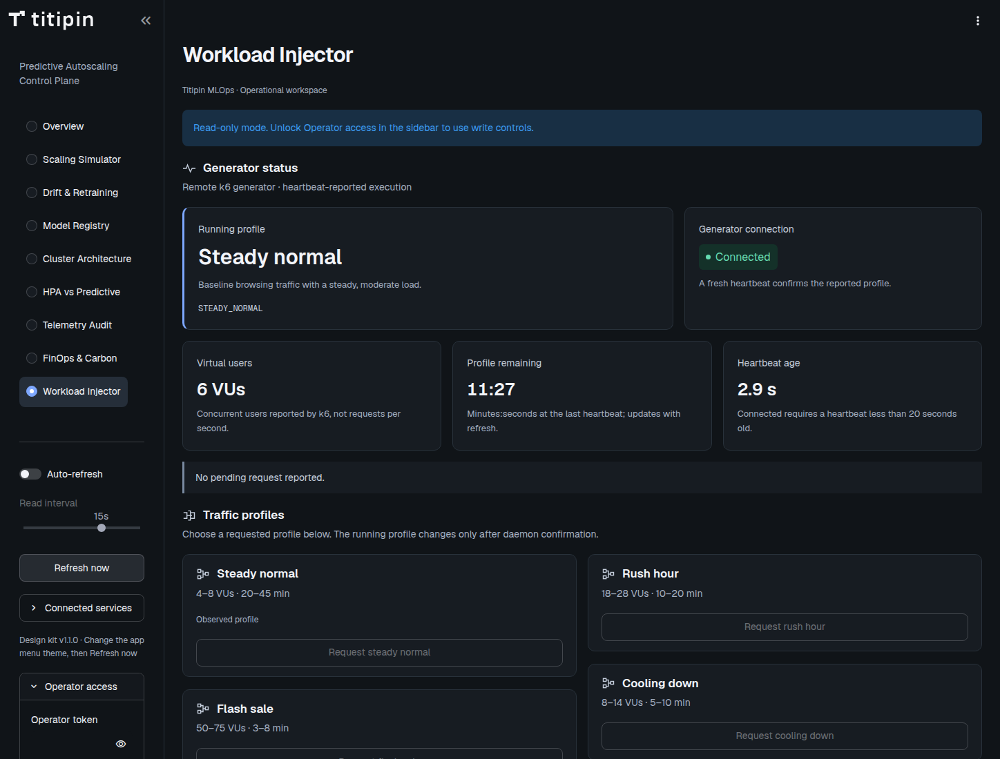

# Audit 006: Generator status clarity

13 Oktober 2026. Audit dilakukan setelah implementasi sesuai pilihan pengguna. Scope: status generator pada Workload Injector, stylesheet scoped, dokumentasi dan mount stylesheet ConfigMap. Pengguna meminta profil yang sedang berjalan lebih jelas dan status penting tidak lagi berupa daftar kecil dalam satu card.

Arah visual: console operator teknis dengan charcoal/blue/teal, Geist/Geist Mono dan kit v1.1.0. ENERGY 1 / RHYTHM 2 / MOTION 1. Nama profil yang diamati menjadi fokus; koneksi, VUs, sisa window dan usia heartbeat mendukung keputusan operator. Tidak ada animasi ambient.

## Perubahan dan alasan desain

| Keputusan | Fungsi |
|---|---|
| Card profil lebih lebar, judul 30px desktop/25px compact | Nama manusiawi seperti Rush hour dapat langsung dikenali; state API tetap detail sekunder. |
| Card koneksi terpisah | Fresh heartbeat dan status last-known tidak tercampur dengan nama profil. Badge selalu mempunyai teks. |
| Tiga card metrik | VUs, menit:detik remaining dan heartbeat age terbaca terpisah dengan satuan/penjelasan. |
| Request strip tersendiri | Profil yang diminta tidak pernah mengganti profil yang dilaporkan sebelum konfirmasi daemon. |
| Layout menumpuk di bawah 1120px | Profil tetap menjadi fokus tanpa memampatkan teks pada tablet/ponsel. Metrik menggunakan grid yang mengikuti lebar konten. |
| Border blue, radius 10px, gap 16px/12px | Mengikuti token/ritme kit dan memberi penekanan hanya pada card profil. |
| Nilai unknown dan label last-reported | Offline tidak terlihat seperti eksekusi aktif; missing tidak berubah menjadi nol. |
| Remaining berupa snapshot heartbeat | Tidak membuat progress bar atau countdown lokal dengan start/durasi total yang tidak disediakan API. |

Pemeriksaan visual menemukan indent bawaan definition list membuat label/angka metrik tidak sejajar dengan catatan. Padding list diperbaiki di stylesheet, lalu browser checks dijalankan ulang. Tidak ada temuan visual blocking tersisa pada scope ini.

## Bukti validasi

- **134 tes Python** suite penuh lolos, termasuk empat skenario baru: observed-versus-pending, offline, missing, serta invalid values/HTML escaping. Dua dependency deprecation warnings lama tetap ada pada Starlette/httpx dan SQLAlchemy/MLflow.
- **8 dataset tests** lolos dengan `-W error`; Ruff lint, format dan whitespace diff lolos.
- [69 generator QA checks](../validation/generator-status/qa.json): 1448/1024/768/390/320px, dark/light, teks 200%, keenam nama profil, pending, offline, empty/error, nol aktual, keyboard refresh, dan tidak ada browser writes.
- [56 generator live checks](../validation/generator-status/live.json): kelima viewport, kedua tema, text resize, keyboard refresh dan tidak ada browser writes pada URL publik; tanpa mengubah workload/training.
- [196 control regression checks](../validation/generator-status/controls/controls.json): navigation, tema, responsive, operator unlock, tombol profil, simulator, retraining, lifecycle, keyboard dan interval refresh; aksi hanya terhadap fixture lokal.
- [12 contrast pairs](../validation/generator-status/contrast.json): foreground/background yang dipakai summary memenuhi 4.5:1 untuk teks dan 3:1 untuk border penekanan. Tidak ada palet baru.
- [Mounted checksums](../validation/generator-status/mounted-sha256.json): keenam berkas yang dikonsumsi pod cocok dengan source lokal.
- [Release verification](../validation/generator-status/release.json): HTTP 200, snapshot daemon, jumlah checks dan metode deployment.

QA memakai fixture sintetis lokal yang terpisah dari produksi. Pemeriksaan produksi hanya membaca halaman dan sumber status; tidak menekan tombol workload, forecast, retraining atau auth.

[Tampilan mobile light produksi](../validation/generator-status/live-light-390.png), [pending request pada fixture QA](../validation/generator-status/qa-pending.png), dan [offline pada fixture QA](../validation/generator-status/qa-offline.png). Screenshot merekam kondisi pada waktu verifikasi, bukan status live permanen.

## Hard gate

| Aturan | Hasil dan bukti |
|---|---|
| R-02 | PASS: copy summary tidak memakai em dash; inspeksi source. |
| R-03 | PASS: 5 lebar viewport dan 200% text memeriksa containment/clipping/overflow; PNG compact dan desktop terlampir. |
| R-17 | PASS: nilai berasal heartbeat; unit dan freshness dijelaskan; tidak menambah angka kinerja. |
| R-18 | PASS: tidak ada testimonial. |
| R-23 | PASS: penataan ulang diminta pengguna; logo/ikon/navigasi yang ada dipertahankan. |
| R-24 | PASS: tidak menambah route/link UI; existing service links diperiksa control regression. |
| R-25 | PASS: 12 pasangan warna token diuji dengan luminance formula. |
| R-26 | PASS: tidak menambah tombol dekoratif; 196 control checks memeriksa handler yang ada. |
| R-27 | PASS: spinner pembacaan, missing/HTTP error dan offline diuji; tidak ada default profil palsu. |
| R-28 | PASS: tidak menambah FAQ. |
| R-32 | PASS: keyboard Refresh now dengan focus-visible dan Enter diuji; tidak menambah interaksi mouse-only. |
| R-33 | PASS: renderer dan CSS ditulis langsung di source; tidak ada script rewrite runtime. |
| R-34 | PASS: theme tokens dark/light dan reflow diuji ulang setelah alignment fix. |
| R-35 | PASS: `.venv`, browser QA, mounted checksum dan rollout; tidak ada Docker lokal. |
| R-36 | PASS: tidak mengklaim real-time streaming, benchmark baru, SSO atau zero downtime. |
| R-37 | PASS: arah visual dan dials mengikuti kit dan tercatat sebelum implementasi. |
| R-38 | PASS: pending bukan running, offline last-known, missing unknown, nol aktual tetap nol. |

## Purpose gate

| Aturan | Hasil dan alasan |
|---|---|
| R-01 | PASS: tanpa gradient/glow. |
| R-04 | PASS: ikon health yang ada tetap menjelaskan status generator; tidak menambah ikon generik. |
| R-06 | PASS: Geist untuk nama/metrik, Mono hanya state API. |
| R-07 | PASS: tanpa grid latar dekoratif. |
| R-08 | PASS: tidak menambah panah dekoratif. |
| R-09 | PASS: dot + Connected/Heartbeat stale/Unavailable adalah status, bukan badge promosi. |
| R-10 | PASS: tanpa glass/blur. |
| R-12 | PASS: panel flat berbatas, tanpa shadow. |
| R-13 | PASS: tanpa glow. |
| R-14 | PASS: profil/koneksi berbeda lebar sesuai bobot; tiga metrik sebanding; pending berupa strip. |
| R-19 | PASS: tanpa animasi/countdown ambient; reduced-motion global tetap berlaku. |
| R-22 | PASS: tanpa ilustrasi tambahan. |

## Liveliness, craftsmanship dan quality locks

| Pemeriksaan | Hasil dan bukti |
|---|---|
| Dials dan Design Read | PASS: ENERGY 1 / RHYTHM 2 / MOTION 1, dinyatakan sebelum source diubah. |
| Focal point | PASS: human-readable running/last-reported profile, 25–30px; screenshot dan assertion ukuran. |
| Whitespace | PASS: gap memisahkan profil, metrik, pending dan pemilihan traffic; tanpa tinggi kosong tetap. |
| Accent dan identity | PASS: blue pada profil diamati, teks semantik pada koneksi/pending; kit logo/font/surface tetap. |
| C-1 | PASS: alasan font, hierarki, shape, spacing, warna dan snapshot dicatat pada tabel desain. |
| C-2 | PASS: reading/rendering tidak mengirim aksi; tombol lama diuji browser. |
| C-3 | PASS: setiap card langsung menjawab profil, koneksi, jumlah pengguna, waktu dan request generator. |
| C-4 | PASS: ready/pending/offline/error/empty/zero, kedua tema, keyboard dan 200% text diuji. |
| C-5 | PASS: data source dan batas freshness terpisah dari simulasi QA. |
| R-05 | PASS: hierarki mengikuti tugas operator, tanpa template marketing. |
| R-11 | PASS: panel 10px, badge 6px; tidak menjadikan semua elemen pill. |
| R-15 | PASS: tombol request spesifik profil dipertahankan. |
| R-16 | PASS: copy operasional, tanpa marketing buzzwords. |
| R-20 | PASS: isi khusus remote k6 daemon, heartbeat dan coordinator Titipin. |
| R-21 | PASS: kedua tema native berfungsi; screenshot masing-masing terlampir. |
| R-29 | PASS: memakai palet kit yang ada. |
| R-30 | PASS: tidak mengambil layout/identitas produk lain. |
| R-31 | PASS: alasan tiap keputusan utama tertulis dan diperiksa melalui source/PNG. |

## Rilis dan batas pemeriksaan

Hot-deploy memakai image dashboard yang sama. ConfigMap `mlops-dashboard-code` sekarang memuat enam key: `app.py`, `cluster.py`, `cluster.js`, `cluster.css`, `cluster-catalog.json`, dan `dashboard.css`. Deployment ditambah satu subPath mount stylesheet, sehingga perubahan template memicu rolling update. Rollout berhasil; endpoint publik merespons HTTP 200 pada pemeriksaan sesudah update. Backup ConfigMap/deployment sebelum rilis disimpan lokal di `/tmp/generator-dashboard-code-before.json` dan `/tmp/generator-dashboard-before.json`.

Ini pemeriksaan terarah, bukan sertifikasi WCAG atau audit seluruh aplikasi. Window remaining tetap snapshot polling, bukan countdown per detik. Perubahan ini tidak memperbaiki persistensi pending override, fallback telemetry controller, SSO, atau backup off-node. Tidak ada eksperimen beban/training produksi baru untuk refinement visual ini.
